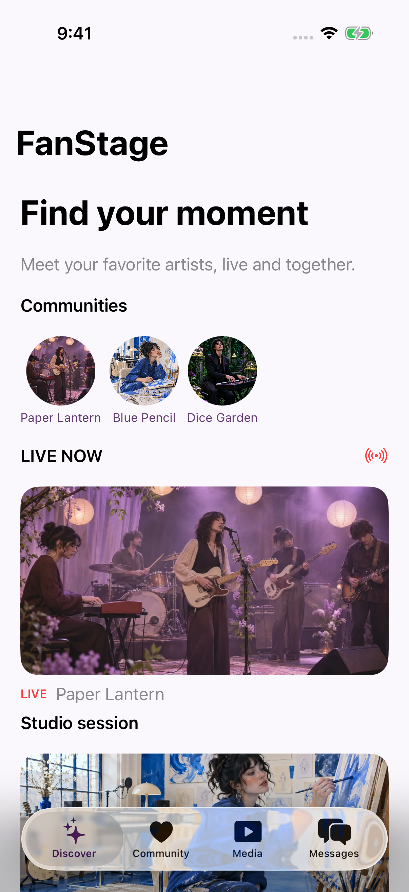
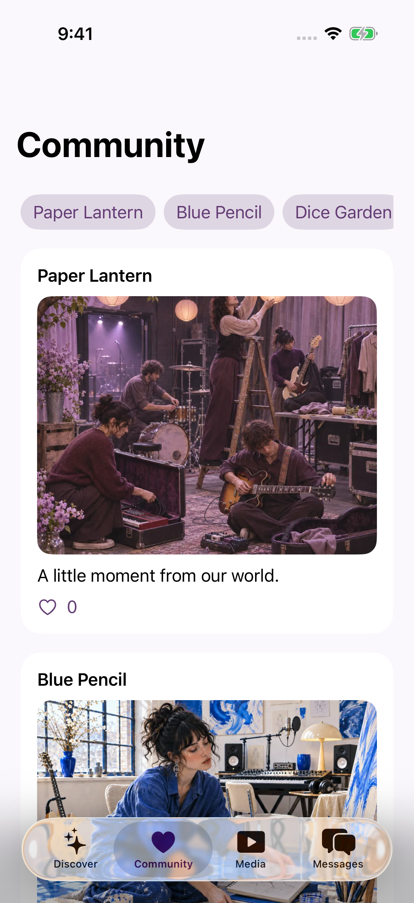
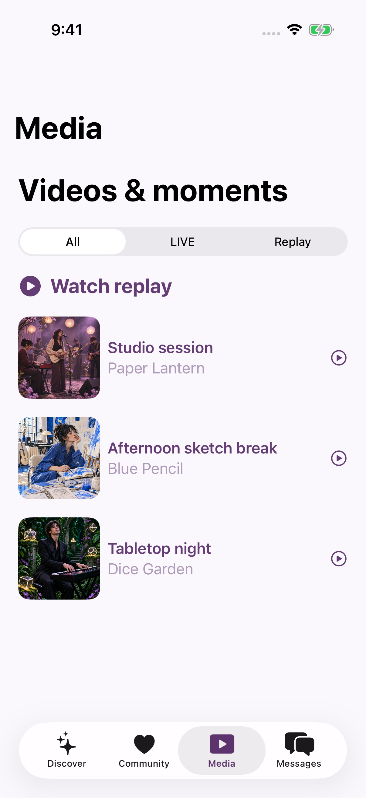
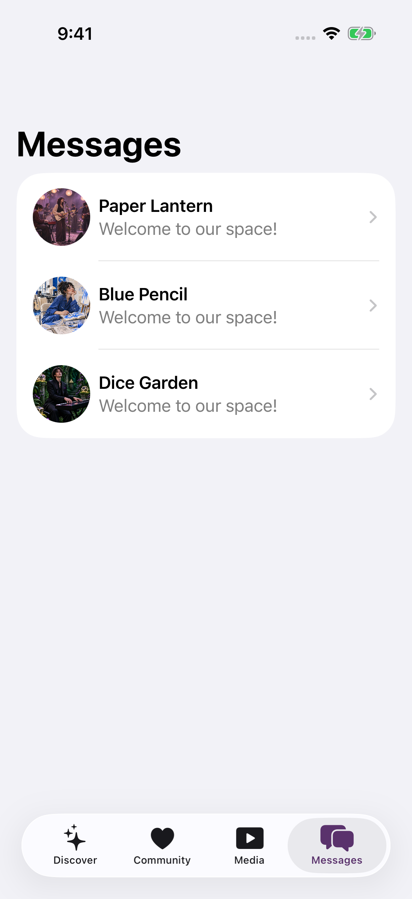
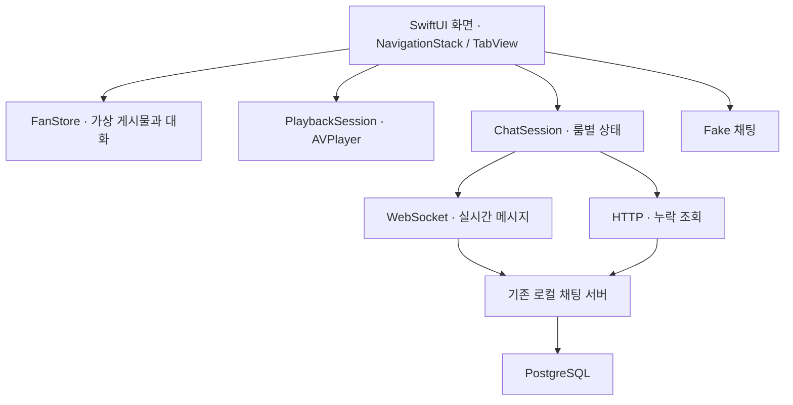

# FanStage iOS

**SwiftUI로 구현 중인 iPhone 미디어·팬 커뮤니티 포트폴리오**

FanStage iOS는 [Android FanStage](https://github.com/CodingBot000/fanstage-android-ai-harness)의 화면과 리소스를 바탕으로 만드는 앱입니다. 가상 아티스트의 커뮤니티와 메시지를 탐색하고, LIVE 화면에서 영상과 채팅을 함께 볼 수 있습니다. iOS에서는 `AVPlayer` 재생 수명주기와 기존 백엔드를 이용한 채팅의 전송·복구를 중점적으로 다룹니다.

**기술 스택:** Swift · SwiftUI · AVFoundation/AVKit · Swift Concurrency · URLSession WebSocket/HTTP · XCTest/XCUITest · Spring Boot · PostgreSQL

**현재 상태:** iOS 17 이상 iPhone, 세로 화면을 지원하는 개발 중인 프로젝트입니다. Android 기능 전체가 이관된 상태는 아닙니다. [Android 기능 대조와 미이관 항목](docs/android-parity.md)

## 앱 화면

아래 화면은 **2026-11-10 iPhone 17 Pro 시뮬레이터(iOS 26.5), Debug 빌드**에서 영어로 촬영했습니다. 상태 표시줄은 시연을 위해 설정했으며, 실기기 화면은 아닙니다. 아티스트·게시물·대화는 가상 데이터입니다.

| Discover | Community |
|:--:|:--:|
|  |  |
| **Media** | **Messages** |
|  |  |

[LIVE와 채팅 화면](docs/screenshots/live.png) · [재생 설정](docs/screenshots/playback-settings.png) · [대화 상세](docs/screenshots/conversation.png)

LIVE 화면의 색상 패턴은 앱에 포함된 **합성 테스트 영상**이고, 화면의 채팅은 기본 Fake 채팅입니다. 실제 생방송이나 실제 아티스트의 대화가 아닙니다. Debug에서는 영상 URL과 로컬 채팅 서버를 별도로 지정할 수 있습니다.

## 주요 구현

### 화면과 데이터

Discover에서 LIVE·Replay와 아티스트 커뮤니티로 이동합니다. Community에서는 게시물·좋아요·댓글을, Media에서는 LIVE·Replay 필터를, Messages에서는 가상 대화를 이용할 수 있습니다. 게시물과 대화는 메모리에 보관되어 앱을 종료하면 초기화됩니다. 한국어·영어 UI 문자열을 제공하며 가상 데이터의 일부 문구는 현지화가 남아 있습니다.

### 영상 재생

`PlaybackSession`이 `AVPlayer`와 관찰자를 관리합니다. 재생·일시정지, 전체 화면, 속도, 제공되는 자막과 최대 비트레이트 설정을 지원합니다. 비트레이트는 스트림에 적용하는 상한 힌트이며 특정 해상도를 보장하지 않습니다. 백그라운드에 들어가면 일시정지하고 화면을 벗어나면 재생 리소스를 정리합니다.

앱 기본 영상은 Android 프로젝트의 합성 HLS를 변환한 MP4입니다. Debug 영상 소스에서 HTTP(S) HLS 또는 MP4 주소를 입력할 수 있습니다. 테스트 HLS의 재생과 자막 선택은 시뮬레이터에서 확인했으며, 전체 화면 전환은 별도 확인이 남아 있습니다.

### LIVE 채팅과 기존 백엔드

`ChatSession`은 룸별 메시지와 전송 상태를 관리합니다. 로컬 서버 모드에서는 WebSocket으로 이벤트를 받고 HTTP로 누락 메시지를 조회합니다. 서버 순번으로 메시지를 병합하고, ACK가 유실되면 미확정 상태를 유지한 채 같은 `clientMessageId`로 재시도합니다. 앱 실행 중에는 룸을 나갔다 돌아와도 미확정 메시지를 메모리에 유지합니다. **앱 종료 후에는 보존되지 않습니다.**

기존 Android 프로젝트의 [Spring Boot·PostgreSQL 채팅 서버](https://github.com/CodingBot000/fanstage-android-ai-harness/tree/main/backend/chat-server)를 변경 없이 재사용합니다. 이 서버는 운영 서비스가 아니라 로컬 개발·검증용입니다. 기본 Fake 채팅은 서버 없이 사용할 수 있으며 실제 서버 연결은 Debug에서 선택합니다.

## 구조



화면·가상 데이터·재생·채팅 책임을 코드에서 나눕니다. 현재 iOS 앱은 단일 Xcode 앱 타깃이며 Android의 Gradle 멀티모듈 구조를 그대로 복제하지 않았습니다.

## 실행 방법

1. Xcode에서 `FanStage.xcodeproj`를 엽니다.
2. iOS 17 이상 iPhone 시뮬레이터를 선택하고 `FanStage` 스킴을 실행합니다.
3. 네 탭과 Fake 데이터, 기본 합성 영상은 별도 서버 없이 확인할 수 있습니다.

실제 채팅을 확인하려면 기존 Android 저장소의 [서버 실행 안내](https://github.com/CodingBot000/fanstage-android-ai-harness/blob/main/backend/chat-server/README.md)에 따라 로컬 서버를 실행합니다. iOS Debug LIVE 화면의 **Chat settings**에서 주소와 일회용 테스트 토큰을 입력합니다. 같은 Mac의 iOS 시뮬레이터는 `http://127.0.0.1:18765`를 사용할 수 있습니다. 실기기는 Mac에 접근할 수 있는 네트워크 주소와 설정이 별도로 필요합니다. 테스트 토큰은 앱에 저장하지 않습니다.

## 테스트와 검증

| 검증 대상 | 확인한 범위 | 환경·근거 |
|---|---|---|
| 기본 빌드와 화면 | Debug 빌드·실행 및 README 화면 촬영 | 2026-11-10, Xcode 26.6, iPhone 17 Pro 시뮬레이터 iOS 26.5 |
| 상태와 화면 흐름 | 게시물·메시지 상태, 룸별 채팅 병합, LIVE·탭 이동과 입력 | [단위 테스트](FanStageTests/FanStageTests.swift) · [UI 테스트](FanStageUITests/FanStageUITests.swift) |
| 기존 서버 채팅 | 격리 서버에서 송수신, 클라이언트 재연결, ACK·발신자 이벤트 유실 후 동일 ID 재시도와 서버 저장 행 한 건 | [채팅 통합 테스트 스크립트](scripts/test-local-chat.sh) |
| HLS | Android 테스트 HLS의 재생 진행과 자막 트랙 선택 | [HLS 테스트 스크립트](scripts/test-hls.sh) |

서버·HLS 테스트는 부팅된 iPhone 시뮬레이터와 Android 저장소가 필요합니다. 기본적으로 같은 상위 폴더의 `FanStage`를 참조하며 다른 위치는 `FANSTAGE_ANDROID_DIR`로 지정합니다.

```bash
./scripts/test-local-chat.sh
./scripts/test-hls.sh
```

채팅 테스트는 별도 Docker Compose 프로젝트와 일회용 자격값을 사용합니다. 종료할 때 컨테이너를 내리지만 테스트 DB 볼륨은 자동 삭제하지 않습니다. 통합 테스트에 필요한 환경이 없으면 해당 테스트는 건너뜁니다.

**남은 확인:** 이벤트 역순·지연 HTTP의 실제 장애 주입, 장시간 리소스 누수, 전체 화면 전환, VoiceOver·Dynamic Type 및 iOS 17 런타임 검증은 수행하지 않았습니다. Android와의 세부 차이는 [기능 대조](docs/android-parity.md)에 기록했습니다.

## 리소스

앱의 가상 아티스트 이미지는 Android 프로젝트에서 재사용한 생성형 이미지입니다. 기본 영상은 Android 프로젝트의 FFmpeg `testsrc2` 합성 영상을 변환한 것입니다. 기존 서버, 테스트 토큰 및 개인 MP4는 이 저장소에 포함하지 않습니다. 원본 프로젝트의 리소스 출처는 [제3자 및 저작물 안내](https://github.com/CodingBot000/fanstage-android-ai-harness/blob/main/THIRD_PARTY_NOTICES.md)를 참고하세요.
